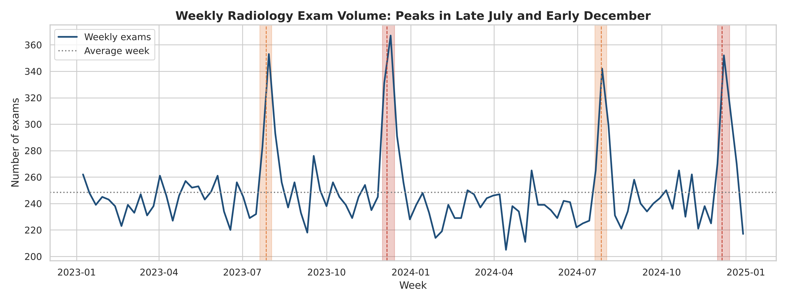
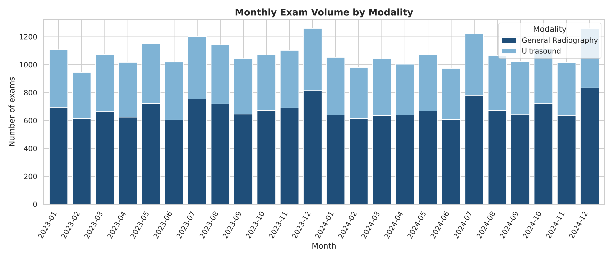
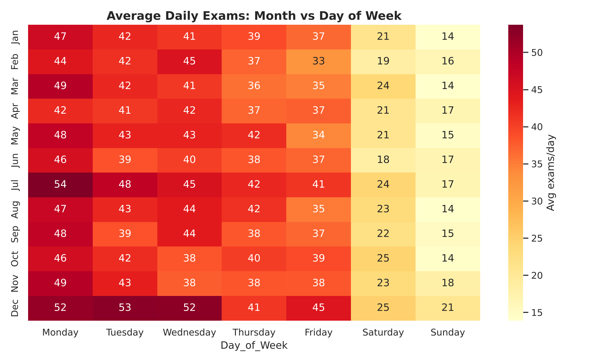

# Radiology Seasonal Demand Analysis

Analysis of 24 months of radiology service volume to identify seasonal demand peaks and support radiographer scheduling and leave planning.

> **Data disclosure:** The dataset in this repository is **synthetic**. It was generated to mirror the seasonal pattern I observe in practice (surges in late July and early December) and contains **no real patient or hospital records**. All figures below come from this synthetic data and demonstrate the method, not real hospital statistics. The notebook runs unchanged on a real anonymized file with the same columns.

## Project Overview & Objective

Radiology departments face predictable surges in demand, yet staff leave and shift patterns are often planned without data. As a radiographer, I see these surges directly: longer queues, tighter shifts, and pressure on both patients and staff.

**Objective:** Quantify how much demand rises during peak periods, identify which modality (general radiography vs ultrasound) and which days drive the surge, and turn the findings into practical scheduling and leave-planning recommendations for the Allied Health Sciences Unit.

**Tools:** Python, pandas, matplotlib, seaborn, Jupyter Notebook

## Key Findings

Based on the synthetic dataset (25,946 exams, Jan 2023 to Dec 2024, averaging about 35 exams per day):

| Period | Avg. weekly exams | Increase vs baseline |
|---|---|---|
| Baseline weeks | 240 | n/a |
| Late July peak (Jul 20 - Aug 2) | 306 | **+27%** |
| Early December peak (Dec 1 - Dec 14) | 320 | **+34%** |

- **General radiography drives the surge.** Its weekly volume rises about 33-43% in peak weeks, versus about 18-19% for ultrasound.
- **Weekdays carry the load, especially Monday and Tuesday.** In peak months these days average roughly 48-54 exams versus about 17-25 on weekends.
- **The pattern repeats.** Both peaks appear in both years, and every statistically unusual week (z-score above 1.5) falls inside these windows. This supports planning ahead rather than reacting.

## Visualizations

### Weekly demand with peak windows highlighted


### Monthly volume by modality


### Busiest days: month vs day of week


## Policy & Staffing Recommendations

Summary of the recommendations presented to the Director of Allied Health Sciences Unit:

1. **Leave-restriction windows.** Limit annual leave for radiographers during late July (Jul 20 - Aug 2) and early December (Dec 1 - Dec 14), and approve leave for these periods early in the year.
2. **Targeted shift adjustments.** Add an overlapping or extended shift on Mondays and Tuesdays during peak weeks, when patient flow is highest.
3. **Modality-focused cover.** Prioritize extra capacity in general radiography, which accounts for most of the increase.
4. **Float or on-call pool.** Pre-arrange cover equal to the estimated extra staffing need (about 1 additional radiographer in peak weeks under the model's assumptions).
5. **Annual review.** Re-run the analysis each year to confirm the pattern and adjust the windows.

## Methodology

1. **Cleaning:** removed duplicates, standardized `exam_type` spellings, handled missing values, parsed dates.
2. **Feature engineering:** Year, Month, Week of Year, Day of Week.
3. **EDA:** total and average volume, weekly z-score spike detection, modality breakdown.
4. **Staffing model:** peak weeks compared with baseline weeks, then converted to radiographer requirements.

## Assumptions & Limitations

- Data is synthetic. Real figures will differ.
- The staffing model assumes **12 exams per radiographer per day** and a **6-day operating week**. These are adjustable in the notebook.
- Only 24 months of data means two observations of each peak. A longer history would give more confidence.
- Demand volume does not capture equipment downtime, staff sickness, or exam complexity.

## Repository Structure

```
radiology-seasonal-demand-analysis/
├── data/
│   ├── anonymized_radiology_volume.csv   # synthetic dataset
│   └── generate_synthetic_data.py        # script that creates it
├── notebooks/
│   └── seasonal_demand_analysis.ipynb    # full analysis with charts
├── visuals/                              # exported charts
├── requirements.txt
└── README.md
```

## How to Run

```bash
git clone https://github.com/<your-username>/radiology-seasonal-demand-analysis.git
cd radiology-seasonal-demand-analysis
pip install -r requirements.txt
cd data && python generate_synthetic_data.py && cd ..
jupyter notebook notebooks/seasonal_demand_analysis.ipynb
```

## Data Privacy

No patient names, national IDs, registration numbers, or exact birth dates are used. The only fields are `exam_id` (random), `exam_date`, `exam_type`, `patient_category`, and `department_or_body_part`.

## About

Created by **[Your Name]**, Radiographer, [City, Country].
LinkedIn: [your link] | Email: [your professional email]
